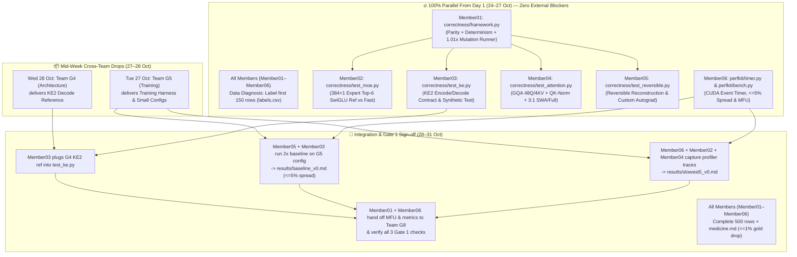

# ⚡ Team G6 (Performance & Kernels) — Complete Task-by-Task Guide

> **Role:** Team 06 (`teams/06-performance/`) — Performance, Profiling, Correctness & Fused Kernels
> **Member Roster Notation:** Generic roles `Member01` through `Member06` (equally balanced workload across 6 core members).

---

## 📌 1. Overview: What Team G6 Must Deliver in Week 1 (Gate 1: Sat 31 Oct, 23:59 IST)

Every member of Team 06 has **two parallel responsibilities** in Week 1:
1. **Individual Data Diagnosis Track (`diagnosis/submissions/<pack_id>/<github-handle>/`):**
   - **Tue 27 Oct, 23:59 IST (3-Day Rule):** Submit at least **150 labelled rows** in `labels.csv` + **90% progress** on your assigned Team 06 code module.
   - **Sat 31 Oct, 23:59 IST (Gate 1):** Submit all **500 labelled rows** in `labels.csv` + `medicine.md` (top 3 diseases, cleaning rules/scripts, before/after examples, and harm test proving $\le 1\%$ change/drop on the gold set).
2. **Team G6 Engineering Track (`teams/06-performance/`):**
   - Build the step profiler (`perfkit/timer.py`), benchmark & MFU harness (`perfkit/bench.py`), correctness & mutation testing framework (`correctness/framework.py`), four architecture correctness suites (`test_ke.py`, `test_attention.py`, `test_moe.py`, `test_reversible.py`), and two baseline reports (`results/baseline_v0.md`, `results/slowest5_v0.md`).
   - **All 3 Gate 1 Verification Checks Must Pass:**
     1. `pytest teams/06-performance/correctness -q` returns **0 failures**.
     2. **Broken-Function Check:** Multiplying any fast kernel output by `1.01` causes the test to **FAIL**.
     3. **Repeatability Check:** Two consecutive baseline runs agree within **$\le 5\%$** for every component of the training step.

---

## 🔄 2. What Runs in Parallel vs. Sequential Dependencies

### Summary of Parallelism
- **What does NOT wait for any other team (Start Immediately in Parallel on Day 1):**
  1. `perfkit/timer.py` and `perfkit/bench.py` (`Member06`) can be built and unit-tested immediately using synthetic PyTorch dummy layers.
  2. `correctness/framework.py` (`Member01`) has zero external dependencies.
  3. `test_moe.py` (`Member02`), `test_attention.py` (`Member04`), and `test_reversible.py` (`Member05`) can be written and tested immediately against standalone V5-shape reference modules (`D=3072`, `H=48Q/4KV`, `E=384+1`, `top-6`).
  4. `test_ke.py` (`Member03`) can scaffold its test harness and synthetic projection test immediately, then swap in G4's exact `ke2_decode` function when G4 delivers it on **28 Oct**.
  5. **All 6 members** can run their Data Diagnosis labelling (`labels.csv` rows `0..149` by **27 Oct**, `0..499` + `medicine.md` by **31 Oct**) completely independently.
- **What waits for 27–28 Oct:**
  - Generating the final numbers in `results/baseline_v0.md` and `results/slowest5_v0.md` waits for **Team G5's harness & small configs on 27 Oct**.
  - Finalizing the KE2 decode reference import in `test_ke.py` waits for **Team G4's reference on 28 Oct**.

---

## 📚 3. Common Foundation: What ALL Members Must Study & Practice First

Before diving into individual modules, every member (`Member01`–`Member06`) should complete this shared baseline:

### A. Shared Prerequisite Reading (All Members)
1. **Data Diagnosis Specification & Cleaning Pipeline (For everyone's `labels.csv` & `medicine.md`):**
   - **Lab Spec:** `diagnosis/DISEASES.md` and `diagnosis/submissions/README.md` in `era-v5-lab` (Disease codes `CLEAN`, `A1`–`G2`, severity `0`–`3`, and the $\le 1\%$ gold-set harm rule).
   - **Session Notes:** `sessions/session_04_data_cleaning_and_deduplication.md` (FineWeb/Gopher/C4 filtering heuristics, line-level boilerplate removal, MinHash LSH, and regex PII scrubbing).
   - **Papers:** *The FineWeb Datasets* (`arXiv:2406.17557`) and *Dolma* (`arXiv:2402.00159`).
2. **V5 Architecture & Training Loop Fundamentals (For all G6 tasks):**
   - **Session Notes:** `sessions/session_10_training_loop_fundamentals.md` (BF16 vs. FP8 E4M3/E5M2 precision, MFU math, gradient accumulation, and autograd verification).
   - **Session Notes:** `sessions/system_walkthroughs/session_16_system_walkthrough.md` (End-to-end V5 model tensor shapes and forward/backward flow).
   - **Triton Basics:** Triton Tutorials `01-vector-add` and `02-fused-softmax` (understanding `@triton.jit`, `tl.program_id`, block pointers, masks, and `torch.autograd.Function` wrappers).

### B. Shared Practice Exercises (All Members — 60 mins)
1. **Practice 1 (Data Diagnosis CLI):** Run `python diagnosis/tools/view_pack.py <your-pack.parquet> --start 0 --hex` to inspect hidden Unicode/control characters (`ZWSP`, `SHY`, `U+FFFD`, PUA characters) and label your first 10 rows manually before writing regex scanners.
2. **Practice 2 (The `1.01×` Mutation Test Pattern):** Write a 10-line `pytest` function verifying that `torch.testing.assert_close(ref_out, fast_out * 1.01)` raises an `AssertionError`. Every single G6 test file must enforce this!

---

## 🛠️ 4. Task-by-Task Breakdown (`Member01` to `Member06`)

---

### 👤 `Member01` (Team Lead Track)
**Assigned Tasks:**
- **Primary Code Deliverable (`G6-W1-03`):** `teams/06-performance/correctness/framework.py`
- **Integration & Gate Deliverable (`G6-W1-10`):** Final Gate 1 verification across all modules + Cross-team sync with G4 (Architecture), G5 (Training), and G8 (Monitoring).

#### 1. What to Study (with References)
- **Numerical Precision & Tolerances:** `sessions/session_10_training_loop_fundamentals.md` (Why BF16 has 7 mantissa bits $\approx 7.8 \times 10^{-3}$ step size, FP32 accumulation in reductions, and choosing `rtol`/`atol` so genuine bugs fail while benign BF16 rounding passes).
- **Training Stability & Silent Bugs:** `docs/ERA_V5_SESSION15_NOTES.md` (§4–6 on silent numerical corruption, gradient spikes, and NaN/Inf propagation).
- **PyTorch Testing & Determinism Docs:** `torch.testing.assert_close`, `torch.use_deterministic_algorithms(True)`, and RNG state snapshotting (`torch.cuda.get_rng_state` / `set_rng_state`).

#### 2. What to Practice
- Build a standalone function `assert_kernel_correctness(ref_fn, fast_fn, inputs, dtype)` that:
  1. Clones and detaches `inputs` with `requires_grad=True` for both `ref_fn` and `fast_fn`.
  2. Runs forward on both and compares outputs (`max_abs_err`, `max_rel_err`, `cosine_similarity`).
  3. Runs backward with an identical upstream gradient `grad_out` and compares all input gradients (`x.grad`) and parameter gradients (`p.grad`).
  4. Runs `fast_fn` a second time with the exact same seed/inputs and asserts `torch.equal(out1, out2)` (bit-determinism).
  5. Multiplies `fast_out` by `1.01` and asserts that the parity check **raises `AssertionError`** (the mandatory Gate 1 negative test).

#### 3. Step-by-Step Execution
- **Days 1–2 (24–25 Oct):** Publish `teams/06-performance/correctness/framework.py` early so `Member02`, `Member03`, `Member04`, and `Member05` can import your `check_parity_and_mutation()` helper directly into their `test_*.py` files.
- **Days 3–4 (26–27 Oct):** Complete 150 rows of personal Data Diagnosis (`labels.csv`) and verify that `pytest teams/06-performance/correctness -q` runs cleanly on CI.
- **Days 5–7 (28–31 Oct):** Receive G5 harness (27 Oct) and G4 KE2 reference (28 Oct), verify all 3 Gate 1 checks across the team, and sign off on G8 MFU handoff.

---

### 👤 `Member02` (Sparse MoE Kernels & Performance Track)
**Assigned Tasks:**
- **Primary Code Deliverable (`G6-W1-06`):** `teams/06-performance/correctness/test_moe.py`
- **Shared Profiling Deliverable (`G6-W1-09`):** MoE step-time & kernel launch trace in `teams/06-performance/results/slowest5_v0.md`
- **Week 2–3 Progression:** Fused Triton MoE Token Permutation (`dispatch`/`combine`) + Grouped SwiGLU Expert Kernel.

#### 1. What to Study (with References)
- **V5 Fine-Grained MoE Architecture:** `sessions/session_14_mixture_of_experts.md` (`384` routed experts + `1` shared expert, `top-6` routing per token, expert hidden dim `d_ff=512`, SwiGLU activation, and auxiliary-loss-free load-balancing bias $b_i$).
- **Papers:**
  - *DeepSeekMoE* (`arXiv:2401.06066` §2–3: Fine-grained expert segmentation & isolated shared expert).
  - *DeepSeek-V3 Technical Report* (`arXiv:2412.19437` §3: Auxiliary-loss-free load balancing & MoE grouped GEMM).
  - *MegaBlocks* (`arXiv:2211.15841`) and *ScatterMoE* (`arXiv:2403.08245`): Avoiding token padding waste and intermediate memory materialization via block-sparse / fused scatter-gather kernels.
- **Book Chapters & Tutorials:**
  - *PMPP* (`books/pmpp/code/README.md`) **Ch. 9 (Parallel Histogram)** and **Ch. 11 (Prefix Sum / Scan)** — how to count tokens per expert and compute contiguous expert buffer offsets on GPU without CPU-GPU `.item()` sync stalls.
  - **GPU MODE Lecture 19** — Grouped GEMMs in Triton.

#### 2. What to Practice
- Write a PyTorch reference MoE block (`ref_moe`) with `E_routed` experts, `1` always-on shared expert, `top_k=6` routing, and SwiGLU (`F.silu(w_gate(x)) * w_up(x)`).
- Write a fast candidate MoE (`fast_moe`) that sorts/permutes tokens into expert-contiguous order (`argsort` / histogram prefix-sum), runs batched/grouped expert projections (or fused Triton SwiGLU/permute), and unpermutes/combines weighted outputs without any Python loop over empty experts.
- Test edge cases where **some experts receive 0 tokens** and **1 expert receives 80% of tokens** (skewed routing).

#### 3. Step-by-Step Execution
- **Days 1–3 (24–27 Oct):** Implement `teams/06-performance/correctness/test_moe.py` importing `Member01`'s `framework.py` (testing uniform routing, skewed routing, empty experts, backward router/expert weight gradients, bit-determinism, and the `1.01×` perturbation failure check) + complete 150 rows of Data Diagnosis (`labels.csv`).
- **Days 4–6 (28–30 Oct):** Profile the MoE layer under `torch.profiler` once G5's harness lands, documenting why naive Python expert loops or unpermuted launches bottleneck the step in `results/slowest5_v0.md`.
- **Day 7 (31 Oct):** Complete 500 rows of `labels.csv` + `medicine.md`.

---

### 👤 `Member03` (KE2 Encode/Decode Kernels & Baseline Track)
**Assigned Tasks:**
- **Primary Code Deliverable (`G6-W1-04`):** `teams/06-performance/correctness/test_ke.py`
- **Shared Benchmark Deliverable (`G6-W1-08`):** Co-author `teams/06-performance/results/baseline_v0.md` (specifically KE2 encode/decode timings & 2-run $\le 5\%$ spread verification)
- **Week 2–3 Progression:** Fused Triton KE2 Encode/Decode kernel & G5 training-arm timings.

#### 1. What to Study (with References)
- **Embedding & Output Head Bottlenecks:** `sessions/system_walkthroughs/session_16_system_walkthrough.md` (How large-vocabulary embedding encode and output decode/LM-head projections consume memory bandwidth and FLOPs).
- **Papers:**
  - *Cut Your Losses in Large-Vocabulary Language Models / Cut Cross-Entropy* (`arXiv:2411.09009`) — How to fuse decode projection / cross-entropy in SRAM without materializing massive `[B, S, V]` logit tensors in HBM.
  - *Liger Kernel* (`arXiv:2410.10989`) — Fused linear + loss / embedding operations in Triton.
- **Tutorials:** Triton Tutorials `01-vector-add`, `02-fused-softmax`, and `03-matrix-multiplication` (`tl.dot`, 2D block tiling, and L2 cache swizzling).

#### 2. What to Practice
- Build a clean adapter interface in `test_ke.py` that tests `ke2_encode` and `ke2_decode` reference vs. fast candidate functions for forward output parity, backward embedding/projection gradient parity, bit-determinism, and the `1.01×` failure check.
- Practice wrapping a `torch.compile` or `@triton.jit` fused projection kernel inside a `torch.autograd.Function` so both forward activations and backward weight gradients match PyTorch eager.

#### 3. Step-by-Step Execution
- **Days 1–3 (24–27 Oct):** Build `teams/06-performance/correctness/test_ke.py` using a modular KE2 contract (so `pytest` passes 90% gate by Tuesday 27 Oct) + complete 150 rows of Data Diagnosis (`labels.csv`).
- **Day 4 (Wed 28 Oct):** Integrate **Team G4's official KE2 decode reference** as soon as it drops on 28 Oct and verify all parity and `1.01×` mutation checks pass.
- **Days 5–7 (29–31 Oct):** Co-run the 2 baseline timing passes with `Member05` for `results/baseline_v0.md` and finish 500 rows + `medicine.md`.

---

### 👤 `Member04` (Hybrid SWA + Full GQA Attention Kernels Track)
**Assigned Tasks:**
- **Primary Code Deliverable (`G6-W1-05`):** `teams/06-performance/correctness/test_attention.py`
- **Shared Profiling Deliverable (`G6-W1-09`):** Attention & QK-Norm/RoPE trace analysis in `teams/06-performance/results/slowest5_v0.md`
- **Week 2–3 Progression:** Fused Triton QK-RMSNorm + RoPE kernel & FlashAttention / FlexAttention sliding-window (`W=512`) optimization.

#### 1. What to Study (with References)
- **V5 Hybrid Attention Architecture:** `sessions/first_principles/session_16_first_principles.md` (§2: **3:1 Interleaved Sliding Window Attention (`W=512`) + Full Causal Attention**, **Grouped-Query Attention (`48` Q heads / `4` KV heads = 12:1 group ratio, `head_dim=64`)**, and **QK-Norm** before softmax to prevent attention logit collapse).
- **Papers:**
  - *FlashAttention-1* (`arXiv:2205.14135`), *FlashAttention-2* (`arXiv:2307.08691`), and *FlashAttention-3* (`arXiv:2407.08608`) — Online softmax rescaling ($m_i, \ell_i$), SRAM tiling, and causal/local window block masking.
  - *Liger Kernel* (`arXiv:2410.10989`) — Fused RMSNorm and RoPE in Triton.
- **Tutorials:** Triton Tutorial `05-layer-norm` and `06-fused-attention`.

#### 2. What to Practice
- Implement an exact PyTorch math reference (`ref_attention`) that:
  1. Applies **QK-Norm** (RMSNorm per head on $Q$ and $K$) and **RoPE**.
  2. Expands $4$ KV heads to $48$ Q heads (`repeat_interleave(12, dim=1)`).
  3. Applies either a **Causal Mask** ($j \le i$) for full-attention layers or a **Sliding Window Mask** ($\max(0, i - W + 1) \le j \le i$ with $W=512$) for local layers.
- Compare against a fast candidate (`fast_attention` using `F.scaled_dot_product_attention` / `FlexAttention` / Triton kernel) across both forward and backward (`dQ, dK, dV, dW_qknorm`) and verify the `1.01×` perturbation check fails.

#### 3. Step-by-Step Execution
- **Days 1–3 (24–27 Oct):** Build `teams/06-performance/correctness/test_attention.py` covering both Sliding Window (`W=512`) and Full Causal GQA (`48Q/4KV`, `d=64`) with QK-Norm + complete 150 rows of Data Diagnosis (`labels.csv`).
- **Days 4–6 (28–30 Oct):** Profile QK-Norm + RoPE + Attention kernel launches under `torch.profiler` and contribute the Attention bottleneck section of `results/slowest5_v0.md`.
- **Day 7 (31 Oct):** Complete 500 rows of `labels.csv` + `medicine.md`.

---

### 👤 `Member05` (Reversible Residual Block & Bit-Determinism Track)
**Assigned Tasks:**
- **Primary Code Deliverable (`G6-W1-07`):** `teams/06-performance/correctness/test_reversible.py`
- **Shared Benchmark Deliverable (`G6-W1-08`):** Co-author `teams/06-performance/results/baseline_v0.md` (running the 2 consecutive baseline runs and proving $\le 5\%$ variation per part)
- **Week 2–3 Progression:** Fused Bit-Deterministic Reversible Residual + RMSNorm Triton Kernel.

#### 1. What to Study (with References)
- **Reversible Residual Math & Custom Autograd:**
  - `sessions/first_principles/session_16_first_principles.md` (§1: Forward equations $Y_1 = X_1 + F(X_2)$ and $Y_2 = X_2 + G(Y_1)$; Backward exact activation reconstruction without storing intermediate activations: $X_2 = Y_2 - G(Y_1)$ and $X_1 = Y_1 - F(X_2)$).
  - `sessions/system_walkthroughs/session_16_system_walkthrough.md` (§1: Writing a custom `torch.autograd.Function` for a reversible block that frees activations in `forward` and reconstructs them in `backward`).
- **Papers & Book Chapters:**
  - *The Reversible Residual Network: Backpropagation Without Storing Activations (RevNet)* (`arXiv:1707.04585`) and *Reformer* (`arXiv:2001.04451` §3).
  - *PMPP* (`books/pmpp/code/README.md`) **Ch. 10 (Reduction Trees)** — Why floating-point addition is non-associative, why `atomicAdd` is non-deterministic across GPU thread blocks, and why reversible blocks require **strictly deterministic** forward kernels so reconstructed $(X_1, X_2)$ match the forward pass bit-for-bit.

#### 2. What to Practice
- Write two versions of a reversible block:
  1. `ref_reversible`: Standard PyTorch autograd (stores $X_1, X_2$ on the autograd tape).
  2. `fast_reversible`: Custom `torch.autograd.Function` that only saves the final output $(Y_1, Y_2)$ and RNG states, reconstructs $(X_1, X_2)$ during `backward()`, and accumulates $\nabla X_1, \nabla X_2, \nabla \theta_F, \nabla \theta_G$.
- Write tests verifying:
  - Reconstructed $(X_1, X_2)$ match original inputs within tight tolerance (and bit-identically in FP32/deterministic mode).
  - Custom backward gradients ($\nabla X_1, \nabla X_2, \nabla \theta_F, \nabla \theta_G$) match standard PyTorch autograd.
  - Multiplying the output by `1.01` fails the test.

#### 3. Step-by-Step Execution
- **Days 1–3 (24–27 Oct):** Implement `teams/06-performance/correctness/test_reversible.py` + complete 150 rows of Data Diagnosis (`labels.csv`).
- **Days 4–6 (28–30 Oct):** Once G5's harness lands on 27 Oct, run two consecutive baseline runs using `Member06`'s `perfkit/bench.py`, verify $\le 5\%$ run-to-run spread across all parts, and write `teams/06-performance/results/baseline_v0.md` with GPU model and commit SHA (with `Member03`).
- **Day 7 (31 Oct):** Complete 500 rows of `labels.csv` + `medicine.md`.

---

### 👤 `Member06` (Step Profiler, Benchmark Harness & MFU Engine Track)
**Assigned Tasks:**
- **Primary Code Deliverables (`G6-W1-01` & `G6-W1-02`):** `teams/06-performance/perfkit/timer.py` and `teams/06-performance/perfkit/bench.py`
- **Shared Profiling & Handoff Deliverables (`G6-W1-09` & `G6-W1-10`):** Lead synthesis of `teams/06-performance/results/slowest5_v0.md` + System metrics & MFU formula handoff to **Team G8 (Monitoring)**
- **Week 2–3 Progression:** Shared H100 node baseline (`speed_v1.md`) & Dry Run 1 full-width `torch.profiler` / Nsight Systems (`nsys`) traces.

#### 1. What to Study (with References)
- **Scaling Laws & Sparse MoE FLOP / MFU Accounting:**
  - `sessions/session_16_scaling_laws_and_compute_planning.md` — How to calculate active FLOPs per token for a Sparse MoE model ($6 N_{\text{active}} + \text{Attention FLOPs}$, where only the shared expert + top-6 of 384 routed experts count toward $N_{\text{active}} \approx 2.68\text{B}$, not the full $15\text{B}$ parameter count!).
  - `sessions/session_10_training_loop_fundamentals.md` — MFU definition ($\text{Achieved FLOP/s} \div \text{GPU Peak BF16/FP8 FLOP/s}$).
- **Papers & Profiling Guides:**
  - *OLMo 2* (`arXiv:2501.00656` §3: Step-time telemetry and MFU reporting).
  - *PMPP* (`books/pmpp/code/README.md`) **Ch. 4–6 (Compute Architecture & Memory Hierarchy)** + **NVIDIA Nsight Systems (`nsys`) & `torch.profiler` Guide** — Why calling `torch.cuda.synchronize()` inside a layer kills pipeline overlap, and how to use **deferred `torch.cuda.Event(enable_timing=True)` pairs** that only synchronize once at the end of a step.

#### 2. What to Practice
- Build a `StepTimer` class in `perfkit/timer.py`:
  - Uses `with timer.section("moe"):` context managers.
  - When `enabled=True`, records `(start_event, end_event)` pairs on the current CUDA stream without blocking the CPU, and computes elapsed milliseconds in `step_end()` after a single `torch.cuda.synchronize()`.
  - When `enabled=False`, yields immediately via a `nullcontext` so it adds **zero overhead** during production training (an explicit requirement in `G6_Instructions.md`).
- Build `perfkit/bench.py`:
  - Runs $N_{\text{warmup}}$ warmup steps (default 5) followed by $N_{\text{steps}}$ timed steps (default 20).
  - Runs **two back-to-back baseline passes** (`Run A` and `Run B`) and automatically computes the percentage spread $|t_A - t_B| / \text{mean}(t_A, t_B) \times 100\%$ for every section, asserting $\le 5\%$.
  - Exports a clean Markdown table ready to paste into `results/baseline_v0.md` and JSON metrics ready for Team G8.

#### 3. Step-by-Step Execution
- **Days 1–3 (24–27 Oct):** Implement `teams/06-performance/perfkit/timer.py` and `teams/06-performance/perfkit/bench.py` (with unit tests proving zero overhead when disabled and $\le 5\%$ spread calculation) + complete 150 rows of Data Diagnosis (`labels.csv`).
- **Days 4–6 (28–30 Oct):** Hook `StepTimer` and `torch.profiler` into G5's training step (delivered 27 Oct), identify the top 5 slowest components, and compile `teams/06-performance/results/slowest5_v0.md` with `Member02` and `Member04`.
- **Day 7 (31 Oct):** Hand off the MFU calculation and timer metric dictionary schema to **Team G8 (Monitoring)** + complete 500 rows of `labels.csv` + `medicine.md`.

---

## 📅 5. Master Day-by-Day Execution Checklist (Week 1: 24–31 Oct)

| Day | Personal Track (All `Member01`–`Member06`) | Team G6 Code & Benchmark Track (`teams/06-performance/`) |
| :--- | :--- | :--- |
| **Day 1–2 (Sat 24 – Sun 25 Oct)** | Inspect assigned `.parquet` pack with `view_pack.py`; build regex/heuristic pre-screener; label rows `0..75`. | **`Member01`** publishes `correctness/framework.py`. **`Member06`** builds `perfkit/timer.py`. **`Member02`–`Member05`** scaffold `test_moe.py`, `test_ke.py`, `test_attention.py`, `test_reversible.py`. |
| **Day 3 (Mon 26 Oct)** | Label rows `76..149` of `labels.csv` and verify against `DISEASES.md`. | All `test_*.py` suites wired into `framework.py` (`pytest` passes locally, `1.01×` check fails as expected). **`Member06`** finishes `perfkit/bench.py`. |
| **Day 4 (Tue 27 Oct — 🚨 3-DAY GATE)** | **Open PR with $\ge 150$ rows in `labels.csv` before 23:59 IST** (`pr-guard` green). | **Commit 90% complete `perfkit/` & `correctness/` modules before 23:59 IST.** Receive **G5 harness & small configs**. |
| **Day 5 (Wed 28 Oct)** | Label rows `150..325` of `labels.csv`. | Receive **G4 KE2 decode reference** -> **`Member03`** plugs into `test_ke.py`. **`Member05` & `Member03`** run 2-pass baseline on G5 config. |
| **Day 6 (Thu 29 Oct)** | Label rows `326..499` of `labels.csv` (all 500 done). | **`Member05` & `Member03`** commit `results/baseline_v0.md` ($\le 5\%$ spread verified). **`Member06`, `Member02`, `Member04`** capture traces for `results/slowest5_v0.md`. |
| **Day 7 (Fri 30 Oct)** | Write `medicine.md` (top 3 diseases, cleaning rules, before/after examples, $\le 1\%$ gold-drop harm test). | Commit `results/slowest5_v0.md`. **`Member01` & `Member06`** hand off MFU & system metrics to **Team G8**. |
| **Day 8 (Sat 31 Oct — 🚨 GATE 1)** | **Final PR merged/updated with 500 rows in `labels.csv` + `medicine.md` before 23:59 IST.** | **Final Gate 1 verification:** (1) `pytest teams/06-performance/correctness -q` == 0 failures, (2) `1.01×` mutation fails, (3) 2 baseline runs agree $\le 5\%$. |
