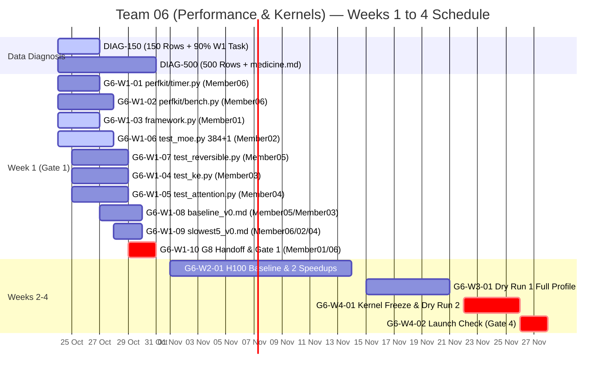

# ⚡ ERA V5 Capstone — Team 06 (Performance & Kernels) Public Tracker

> **Snapshot Date:** `2026-10-25` · **Commit:** `9d77700` · **Team Folder:** `teams/06-performance/` · **Full Guide:** [TEAM_G6_TASK_GUIDE.md](./TEAM_G6_TASK_GUIDE.md)
>
> **How to Update:** Edit `tracker/*.json` (or submit a PR) and run `python scripts/build.py` to regenerate both `TRACKER.md` and `dist/index.html`.

## 📊 Summary Strip

| Metric | Progress | Next Hard Gate | Target |
| :--- | :--- | :--- | :--- |
| **Week 1 G6 Tasks** | **0 / 10** Done | **Tue 27 Oct, 23:59 IST** (3-Day Rule) | 150 Diagnosis rows + 90% Week 1 G6 task |
| **Core Data Diagnosis (150 rows)** | **0 / 6** Done | **Sat 31 Oct, 23:59 IST** (Gate 1) | 500 Diagnosis rows + `medicine.md` + G6 Gate 1 |
| **Core Data Diagnosis (500 rows + Med)** | **0 / 6** Done | **Sat 14 Nov** (Gate 2) / **23 Nov** (Freeze) | Shared H100 Baseline, 2 Speedups, Kernel Freeze |

---

## 🚨 Week 1 Gate 1 Acceptance Criteria (Sat 31 Oct, 23:59 IST)

1. **Zero Test Failures:** `pytest teams/06-performance/correctness -q` returns `0` failures.
2. **1.01× Broken Function Check:** Multiplying any fast output by `1.01` causes the correctness suite to **FAIL**.
3. **≤ 5% Baseline Repeatability:** Two consecutive baseline runs agree within `<= 5%` for every part of the training step (`results/baseline_v0.md`).
4. **Individual Data Diagnosis:** Every member (`Member01`–`Member06`) merges `150` rows by **27 Oct** and all `500` rows + `medicine.md` (with `<= 1%` gold drop harm test) by **31 Oct**.

---

## 👥 Task-by-Task Breakdown (`Member01`–`Member06`): Study, Practice & Parallelism

| Member | Role & Assigned Tasks | What to Study (References) | What to Practice & Parallelism | 27 Oct (150) | 31 Oct (500+Med) |
| :--- | :--- | :--- | :--- | :--- | :--- |
| **`Member01`** `M01` | **Core · Team Lead & Correctness Harness** G6-W1-03 (correctness/framework.py: fwd/bwd grad parity, bit-determinism & 1.01x mutation harness), G6-W1-10 (Gate 1 verification & G4/G5/G8 sync) | Session 10 Notes (BF16/FP8 mantissa precision, finite-diff & autograd grad check, rtol/atol); Session 15 Notes (§4–6 silent numerical corruption & spikes); PyTorch Determinism & assert_close docs. | **Practice:** Write assert_kernel_correctness(ref_fn, fast_fn, x) checking: (1) fwd output parity, (2) bwd x.grad & weight.grad parity, (3) torch.equal bit-identical rerun, and (4) fast_out * 1.01 raises AssertionError. **Parallel:** 100% parallel from Day 1 (zero external blockers). Publish framework.py by Day 2 so Member02–Member05 import it. | 🔵 In Progress | ⚪ Planned |
| **`Member02`** `M02` | **Core · Sparse MoE Kernels & Performance** G6-W1-06 (correctness/test_moe.py: 384 routed + 1 shared expert, top-6 token permute & SwiGLU fwd/bwd parity + skewed/empty load tests), G6-W1-09 (MoE profiler trace), W2 Fused Triton MoE Kernel | Session 14 Notes (384+1 experts, top-6 routing, aux-free bias); Session 16 Walkthrough; DeepSeekMoE (arXiv:2401.06066 §2); DeepSeek-V3 (arXiv:2412.19437 §3); MegaBlocks (arXiv:2211.15841); ScatterMoE (arXiv:2403.08245); PMPP Ch. 9 (Histogram) & Ch. 11 (Prefix Sum/Scan); GPU MODE Lec 19. | **Practice:** Implement ref_moe vs fast_moe (token argsort/prefix-sum permute -> grouped SwiGLU -> weighted unpermute) without .item() host syncs; test uniform routing, 1-expert 80% skew, and 0-token empty experts + 1.01x failure check. **Parallel:** 100% parallel from Day 1 using standalone V5 MoE shapes (D=3072, E=384+1, k=6, d_ff=512). Plug into G5 harness on 28 Oct for slowest5_v0.md trace. | 🔵 In Progress | ⚪ Planned |
| **`Member03`** `M03` | **Core · KE2 Encode/Decode Kernels & Baseline** G6-W1-04 (correctness/test_ke.py: KE2 encode/decode fwd/bwd parity with G4 reference & 1.01x mutation check), G6-W1-08 (KE2 baseline timing), W2 Fused Triton KE2 Kernel | Session 16 System Walkthrough (Embedding & LM Head parameterization); Cut Cross-Entropy / Cut Your Losses (arXiv:2411.09009); Liger Kernel (arXiv:2410.10989); Triton Tutorials 01–03 (vector-add, fused-softmax, matrix-multiplication). | **Practice:** Scaffold test_ke.py with a pluggable ke2_encode / ke2_decode interface, custom torch.autograd.Function wrapper, fwd/bwd weight grad check, bit-determinism, and 1.01x failure check. **Parallel:** Parallel Days 1–3 with synthetic KE2 contract; sequential integration on Wed 28 Oct when Team G4 delivers the KE2 decode reference. | ⚪ Planned | ⚪ Planned |
| **`Member04`** `M04` | **Core · Hybrid SWA + Full GQA Attention Kernels** G6-W1-05 (correctness/test_attention.py: Hybrid 3:1 SWA W=512 + Full GQA 48Q/4KV, QK-norm & RoPE fwd/bwd parity), G6-W1-09 (Attention profiler trace), W2 Fused QK-Norm/RoPE Kernel | Session 16 First Principles §2 (3:1 SWA W=512 + Full Attention, GQA 48Q/4KV, head_dim=64, QK-Norm); FlashAttention-1/2/3 (arXiv:2205.14135, 2307.08691, 2407.08608); Liger Kernel (arXiv:2410.10989); Triton Tutorials 05 & 06. | **Practice:** Write ref_attention (per-head QK-RMSNorm + RoPE + 12x KV repeat + explicit causal & W=512 sliding-window masks) vs fast_attention (SDPA/FlexAttention/Triton); verify dQ, dK, dV, dW_qknorm parity + 1.01x failure check. **Parallel:** 100% parallel from Day 1 using V5 attention shapes (B=2, S=2048, 48Q/4KV, d=64, W=512). Profile under G5 harness on 28–30 Oct. | ⚪ Planned | ⚪ Planned |
| **`Member05`** `M05` | **Core · Reversible Residual Kernels & Repeatability** G6-W1-07 (correctness/test_reversible.py: bit-deterministic reversible state reconstruction & custom autograd backward parity), G6-W1-08 (baseline_v0.md <=5% repeatability runs), W2 Fused Reversible RMSNorm Kernel | Session 16 First Principles §1 (Y1=X1+F(X2), Y2=X2+G(Y1), backward reconstruction X2=Y2-G(Y1), X1=Y1-F(X2)); Session 16 Walkthrough §1 (custom autograd.Function); RevNet (arXiv:1707.04585); Reformer (arXiv:2001.04451); PMPP Ch. 10 (Deterministic Reductions). | **Practice:** Implement custom ReversibleBlockFunction freeing intermediate activations in forward and reconstructing (X1, X2) in backward; assert bit-identical reconstruction and exact grad parity vs standard autograd + 1.01x failure check. **Parallel:** test_reversible.py is 100% parallel from Day 1. Running the 2x baseline for baseline_v0.md starts Tue 27 Oct once Team G5 delivers the training harness. | ⚪ Planned | ⚪ Planned |
| **`Member06`** `M06` | **Core · Step Profiler, Benchmark Harness & MFU Engine** G6-W1-01 (perfkit/timer.py: zero-overhead CUDA Event step timer), G6-W1-02 (perfkit/bench.py: <=5% spread runner & Sparse MoE MFU), G6-W1-09 (slowest5_v0.md), G6-W1-10 (G8 MFU handoff) | Session 16 Scaling Laws & FLOP Math (Sparse MoE active FLOPs: 6*N_active + Attention FLOPs, ~2.68B active of 15B total); Session 10 Notes (MFU ceiling); OLMo 2 (arXiv:2501.00656 §3 telemetry); PMPP Ch. 4–6 & Nsight Systems/Compute Roofline guide. | **Practice:** Build StepTimer with deferred torch.cuda.Event pairs (single sync at step_end) and nullcontext no-op when enabled=False; build bench.py running 2 consecutive baseline passes and asserting <=5% spread for every component. **Parallel:** perfkit/timer.py & bench.py are 100% parallel from Day 1 (unit-tested on synthetic steps). Plug into G5 harness on 27 Oct and hand off schema to G8 by 30 Oct. | ⚪ Planned | ⚪ Planned |

### Incoming Rotation Cohorts (Week 2 & Week 3)

| ID | Cohort | Window | Rotation Task in Team 06 | Parallelism |
| :--- | :--- | :--- | :--- | :--- |
| `R2-01` | **Rotation-W2-Members (7 Members)** | Week 2 (from 1 Nov) | G6-W2-ROT: Each Week 2 rotation member profiles one component of the training step and submits a profiler trace + bottleneck report. | 7 independent component profiles run in parallel during Week 2. |
| `R3-01` | **Rotation-W3-Members (6 Members)** | Week 3 (from 15 Nov) | G6-W3-ROT: Each Week 3 rotation member writes one correctness & 1.01x mutation test for a fast fused kernel in teams/06-performance/correctness/. | 6 independent kernel correctness tests run in parallel during Week 3. |

---

## 🗓️ Week 1 Deliverables & Cross-Team Gates (24–31 Oct 2026)

| Code | Deliverable & Gate | Owner | Due | Status | Evidence / PR |
| :--- | :--- | :--- | :--- | :--- | :--- |
| `DIAG-150` | **3-Day Rule Gate: First 150 labelled rows in labels.csv + 90% Week 1 G6 task progress** **[HARD GATE]** Gate: PR to diagnosis/submissions/<pack_id>/<github-handle>/labels.csv with >=150 valid rows; pr-guard green; 90% proof on assigned Week 1 G6 module. | `All Core Members (Member01–Member06)` | `2026-10-27` | 🔵 In Progress | _Pending PR_ |
| `DIAG-500` | **Week 1 Data Diagnosis Gate: All 500 rows in labels.csv + medicine.md with harm tests** **[HARD GATE]** Gate: All 500 rows labelled in labels.csv + medicine.md (top 3 diseases, regex/script fixes, before/after examples, harm test <=1% gold drop). | `All Core Members (Member01–Member06)` | `2026-10-31` | ⚪ Planned | _Pending PR_ |
| `G6-W1-01` | **Zero-Overhead CUDA Event Step Profiler (teams/06-performance/perfkit/timer.py)** Gate: Deferred-sync CUDA Event timer recording ke_encode, attention, moe, reversible_fwd, loss, backward, optimizer, comms; zero-overhead no-op toggle verified by unit test. | `Member06` | `2026-10-27` | ⚪ Planned | _Pending PR_ |
| `G6-W1-02` | **Repeatability Benchmark Harness & Sparse MoE MFU Engine (teams/06-performance/perfkit/bench.py)** Gate: Warmup + timed steps, p50/p90/mean/std breakdown, tokens/s, Sparse MoE active-FLOP MFU, peak VRAM, and automated check that two baseline runs agree within <=5% for every part. | `Member06` | `2026-10-28` | ⚪ Planned | _Pending PR_ |
| `G6-W1-03` | **Correctness & 1.01x Mutation Test Framework (teams/06-performance/correctness/framework.py)** Gate: Forward parity, backward input/weight grad parity, bit-deterministic rerun check, and 1.01x fast-output mutation negative test. | `Member01 (Lead)` | `2026-10-27` | 🔵 In Progress | _Pending PR_ |
| `G6-W1-04` | **KE2 Encode/Decode Correctness Suite (teams/06-performance/correctness/test_ke.py)** Gate: pytest passes on KE2 encode/decode reference vs fast implementation (integrating G4 reference on 28 Oct) and fails when fast output is multiplied by 1.01. | `Member03` | `2026-10-29` | ⚪ Planned | _Pending PR_ |
| `G6-W1-05` | **Hybrid SWA + Full GQA Correctness Suite (teams/06-performance/correctness/test_attention.py)** Gate: pytest passes on GQA (48Q/4KV, head_dim=64, QK-norm, 3:1 SWA window=512 + Full Attention) forward/backward parity and fails on 1.01x perturbation. | `Member04` | `2026-10-29` | ⚪ Planned | _Pending PR_ |
| `G6-W1-06` | **Fine-Grained 384+1 MoE Token Permute & SwiGLU Correctness Suite (teams/06-performance/correctness/test_moe.py)** Gate: pytest passes on SwiGLU MoE (384 routed + 1 shared expert, top-6 routing, token permutation, uniform + skewed/empty expert loads) forward/backward grad parity and fails on 1.01x perturbation. | `Member02` | `2026-10-28` | 🔵 In Progress | _Pending PR_ |
| `G6-W1-07` | **Reversible Residual Block Bit-Deterministic Reconstruction & Custom Autograd Suite (teams/06-performance/correctness/test_reversible.py)** Gate: pytest passes on exact reversible state reconstruction (X1, X2), custom autograd backward gradient parity vs standard autograd, bit-determinism, and fails on 1.01x perturbation. | `Member05` | `2026-10-29` | ⚪ Planned | _Pending PR_ |
| `G6-W1-08` | **First Baseline Timing Report (teams/06-performance/results/baseline_v0.md)** Gate: Committed baseline_v0.md with GPU name, git commit SHA, per-part ms breakdown on G5 small config, and 2 runs agreeing within <=5% for every part. | `Member05 & Member03` | `2026-10-30` | ⚪ Planned | _Pending PR_ |
| `G6-W1-09` | **Top 5 Bottlenecks, Profiler Traces & Week 2 Kernel Designs (teams/06-performance/results/slowest5_v0.md)** Gate: Committed slowest5_v0.md listing the 5 slowest parts of the training step, each with a torch.profiler trace summary and 1 concrete Week 2 Triton/CUDA optimization proposal. | `Member06, Member02 & Member04` | `2026-10-30` | ⚪ Planned | _Pending PR_ |
| `G6-W1-10` | **System Metrics & MFU Handoff to G8 + Gate 1 Verification** **[HARD GATE]** Gate: All 3 Gate 1 checks pass: (1) pytest teams/06-performance/correctness -q == 0 failures, (2) 1.01x broken function fails, (3) 2 baseline runs agree <=5%. Metrics handed off to G8. | `Member01 & Member06` | `2026-10-31` | ⚪ Planned | _Pending PR_ |
| `DEP-G5` | **Cross-Team Dependency: Receive Harness & Small Configs from Team G5 (Training)** Gate: G5 delivers training harness and small configs for G6 baseline timing. | `Team G5 -> Team G6` | `2026-10-27` | ⚪ Planned | _Pending PR_ |
| `DEP-G4` | **Cross-Team Dependency: Receive KE2 Decode Reference from Team G4 (Architecture)** Gate: G4 delivers KE2 decode reference implementation for test_ke.py. | `Team G4 -> Team G6` | `2026-10-28` | ⚪ Planned | _Pending PR_ |

---

## 📚 Prerequisite Reading, Papers & Practice Checklist (By Member)

| Code | Topic, References & Practice Gate | Owner | Target Date | Status |
| :--- | :--- | :--- | :--- | :--- |
| `READ-ALL` | **Shared Foundation: Data Diagnosis Taxonomy (DISEASES.md) & V5 Training Loop Basics** Study: diagnosis/DISEASES.md (codes A1–G2), Session 4 notes (FineWeb/Dolma filters, <=1% gold drop harm test), Session 10 notes (BF16/FP8 & MFU), and Triton Tutorials 01–02. Practice: Inspect 10 rows with view_pack.py --hex and write a 1.01x assert_close failure test. | `All Members (Member01–Member06)` | `2026-10-26` | 🔵 In Progress |
| `READ-M01` | **Member01 Study & Practice: Numerical Tolerances, Autograd Grad Check & Determinism (framework.py)** Study: Session 10 (BF16/FP8 precision), Session 15 (§4–6 silent bugs & spikes), PyTorch assert_close & determinism docs. Practice: Build assert_kernel_correctness() checking fwd/bwd grads, bit-determinism, and 1.01x mutation failure. | `Member01` | `2026-10-27` | 🔵 In Progress |
| `READ-M02` | **Member02 Study & Practice: Sparse MoE Routing, Token Permutation & Grouped GEMMs (test_moe.py)** Study: Session 14 (384+1 experts, top-6 routing, aux-free bias), DeepSeekMoE (arXiv:2401.06066), DeepSeek-V3 (arXiv:2412.19437 §3), MegaBlocks (arXiv:2211.15841), ScatterMoE (arXiv:2403.08245), PMPP Ch. 9 & 11 (Histogram & Prefix Scan). Practice: Token permute/unpermute without .item() syncs; test skewed/empty experts. | `Member02` | `2026-10-28` | 🔵 In Progress |
| `READ-M03` | **Member03 Study & Practice: Factorized/Kernelized Embedding (KE2) & Cut Cross-Entropy (test_ke.py)** Study: Session 16 System Walkthrough (Embedding/LM Head parameterization), Cut Cross-Entropy (arXiv:2411.09009), Liger Kernel (arXiv:2410.10989), Triton Tutorials 01–03. Practice: Pluggable KE2 encode/decode autograd wrapper & parity suite. | `Member03` | `2026-10-28` | ⚪ Planned |
| `READ-M04` | **Member04 Study & Practice: FlashAttention 1–3, Hybrid 3:1 SWA + Full GQA & QK-Norm (test_attention.py)** Study: Session 16 First Principles §2 (3:1 SWA W=512 + Full Attention, GQA 48Q/4KV, QK-norm), FlashAttention 1–3 (arXiv:2205.14135, 2307.08691, 2407.08608), Liger Kernel (arXiv:2410.10989), Triton Tutorials 05–06. Practice: Explicit SWA/Causal GQA ref vs SDPA/FlexAttention. | `Member04` | `2026-10-28` | ⚪ Planned |
| `READ-M05` | **Member05 Study & Practice: Reversible Residual Networks, Custom Autograd & Bit-Determinism (test_reversible.py)** Study: Session 16 First Principles §1 & Walkthrough §1 (Reversible reconstruction X2=Y2-G(Y1), X1=Y1-F(X2)), RevNet (arXiv:1707.04585), Reformer (arXiv:2001.04451), PMPP Ch. 10 (Deterministic Reductions). Practice: Custom ReversibleBlockFunction without saving intermediate activations. | `Member05` | `2026-10-28` | ⚪ Planned |
| `READ-M06` | **Member06 Study & Practice: Deferred CUDA Events, Roofline Profiling & Sparse MoE MFU (timer.py & bench.py)** Study: Session 16 Scaling Laws & FLOP Accounting (6*N_active + Attention FLOPs), Session 10 (MFU), OLMo 2 (arXiv:2501.00656 §3), PMPP Ch. 4–6 & Nsight Roofline guide. Practice: Deferred CUDA event StepTimer with zero-overhead disabled mode & 2-run <=5% spread verifier. | `Member06` | `2026-10-28` | ⚪ Planned |

---

## 🚀 Weeks 2–4 Capstone Roadmap (Gates 2, 3 & 4)

| Code | Milestone & Gate | Owner | Window | Status | Evidence |
| :--- | :--- | :--- | :--- | :--- | :--- |
| `G6-W2-01` | **Week 2 (Gate 2): Shared H100 Node Baseline, G5 Arm Timings, 2 Fused Triton Speedups & speed_v1.md** Gate: Node baseline on shared H100; time G5 arms; land >=2 kernel speedups (MoE, Attention, Reversible, or KE2) with parity tests; publish speed_v1.md. | `Member01–Member06 (1 Kernel/Profile Track Each) + W2 Rotation` | `2026-11-01` → `2026-11-14` | ⚪ Planned | _Planned_ |
| `G6-W3-01` | **Week 3 (Gate 3): Dry Run 1 Full-Width Profile, MoE Dispatch/All-to-All & Fused Kernels** Gate: Full-width profile of Dry Run 1 (torch.profiler, Nsight); profile MoE dispatch, all-to-all, checkpoint save; test fused kernels against reference. | `Member01–Member06 + W3 Rotation` | `2026-11-15` → `2026-11-21` | ⚪ Planned | _Planned_ |
| `G6-W4-01` | **Kernel Freeze (23 Nov) & Dry Run 2 Speed Comparison** Gate: All production kernels frozen by 23 Nov; Dry Run 2 speed & MFU verified on 24–26 Nov. | `Member01–Member06` | `2026-11-22` → `2026-11-26` | ⚪ Planned | _Planned_ |
| `G6-W4-02` | **Week 4 (Gate 4): Launch Commit Correctness Check & speed_backlog.md** Gate: Full correctness suite passes on launch commit; speed check signed off; speed_backlog.md published before main training run starts on 28 Nov. | `Member01–Member06` | `2026-11-26` → `2026-11-28` | ⚪ Planned | _Planned_ |

---

## 📈 Timeline (Mermaid Gantt)

---

## ⏱️ Benchmark, Parity & 1.01× Mutation Test Results

> A speedup is only valid when **Forward/Backward Parity** passes, the **1.01× Perturbation Check** fails as expected, **Bit-Determinism** holds, and **2 Baseline Runs** agree within `<= 5%`.

| Date | Component / Kernel | Shape | Fast (ms) | Baseline (ms) | Speedup | Run Spread | Parity | 1.01× Check | Deterministic | GPU |
| :--- | :--- | :--- | :--- | :--- | :--- | :--- | :--- | :--- | :--- | :--- |
| `2026-10-27` | **Full Training Step (Small Config Baseline v0)** Target: 2 baseline runs agree within <=5% for each part (results/baseline_v0.md) | `B=2, S=2048, D=3072, BF16` | `—` | `—` | **—** | `—` | ⚪ Pending | ⚪ Pending | ⚪ Pending | Pending G5 harness (27 Oct) |
| `2026-10-29` | **KE2 Encode / Decode (test_ke.py)** Correctness suite + 1.01x perturbation failure check | `B=2, S=2048, D=3072` | `—` | `—` | **—** | `—` | ⚪ Pending | ⚪ Pending | ⚪ Pending | Pending G4 ref (28 Oct) |
| `2026-10-29` | **Hybrid Attention: GQA 48Q/4KV + QK-Norm + SWA/Full (test_attention.py)** Correctness suite + 1.01x perturbation failure check | `B=2, S=2048, H=48/4, d=64, W=512` | `—` | `—` | **—** | `—` | ⚪ Pending | ⚪ Pending | ⚪ Pending | Pending |
| `2026-10-29` | **Fine-Grained MoE: 384 Routed + 1 Shared, Top-6 SwiGLU (test_moe.py)** Uniform + skewed/empty expert loads + 1.01x perturbation failure check | `N=4096, D=3072, E=384+1, k=6, d_ff=512` | `—` | `—` | **—** | `—` | ⚪ Pending | ⚪ Pending | ⚪ Pending | Pending |
| `2026-10-29` | **Reversible Residual Block Reconstruction & Custom Backward (test_reversible.py)** Bit-deterministic reconstruction + custom backward vs standard autograd | `B=2, S=2048, D=3072` | `—` | `—` | **—** | `—` | ⚪ Pending | ⚪ Pending | ⚪ Pending | Pending |

---

## 🧭 Engineering Decisions

| Code | Date | Decision | Rationale | State |
| :--- | :--- | :--- | :--- | :--- |
| `D01` | `2026-10-24` | Use torch.cuda.Event(enable_timing=True) in perfkit/timer.py with synchronization only at step/report boundaries, and a zero-overhead no-op context manager when enabled=False. | Avoids per-layer CPU-GPU sync stalls during training while guaranteeing zero overhead when timing is toggled off (required by G6_Instructions.md). | 🟢 Decided |
| `D02` | `2026-10-24` | Enforce the 3-part correctness contract in correctness/framework.py: (1) forward & backward grad parity, (2) bit-deterministic rerun equality, and (3) automatic failure when the fast output is multiplied by 1.01. | Directly codifies the Week 1 Gate 1 check ('A broken function fails: lead multiplies one fast output by 1.01, and the test fails'). | 🟢 Decided |
| `D03` | `2026-10-24` | Standardize baseline repeatability in perfkit/bench.py using warmup steps, locked clocks/seeds where available, and an automated <=5% run-to-run spread assertion across two consecutive baseline runs. | Required by Week 1 Gate 1 check #3 ('Two baseline runs agree within 5% for each part'). | 🟢 Decided |
| `D04` | `2026-10-24` | Count only non-embedding active parameters (approx 2.68B active of 15B total) + attention FLOPs in the MFU calculation handed off to Team G8. | For sparse MoE (top-6 of 384 routed + 1 shared expert), total-parameter FLOP formulas misreport actual hardware utilization; active FLOPs per token (~6 * N_active + attention FLOPs) gives true MFU. | ⚪ Proposed |

---

## ❓ Cross-Team & Internal Questions

| ID | Target | Question | Answer / Resolution | Status |
| :--- | :--- | :--- | :--- | :--- |
| `Q01` | **Team G5 (Training)** | What are the exact small config dimensions (batch_size, seq_len, d_model, n_layers, n_experts) for the 27 Oct harness handoff so G6 can pre-configure perfkit/bench.py? | _Pending_ | ⚪ Open |
| `Q02` | **Team G4 (Architecture)** | What is the exact function signature and tensor shape contract for the KE2 encode/decode reference landing on 28 Oct? | _Pending_ | ⚪ Open |
| `Q03` | **Team G8 (Monitoring)** | What JSON/dict key schema does G8 expect from perfkit/timer.py and perfkit/bench.py for logging step timings, tokens/s, and MFU? | _Pending_ | ⚪ Open |
| `Q04` | **Team G6 (Internal)** | Which GPU SKU will we standardize on for the Week 1 baseline_v0.md runs so all 2-run <=5% repeatability checks are measured on identical hardware? | _Pending_ | ⚪ Open |
