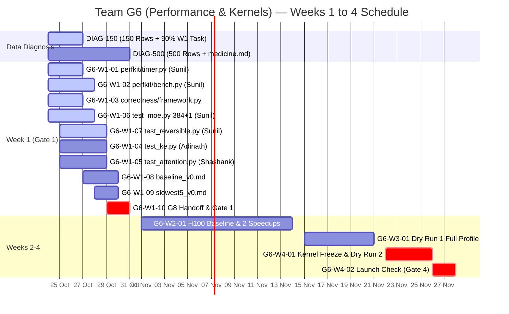

# ⚡ ERA V5 Capstone — Team G6 (Performance & Kernels) Public Tracker

> **Snapshot Date:** `2026-10-24` · **Commit:** `e066174` · **Team Folder:** `teams/06-performance/` · **Team Lead:** Vaibhav Lohar
>
> **How to Update:** Edit `tracker/*.json` (or submit a PR) and run `python scripts/build.py` to regenerate both `TRACKER.md` and `dist/index.html`.

## 📊 Summary Strip

| Metric | Progress | Next Hard Gate | Target |
| :--- | :--- | :--- | :--- |
| **Week 1 G6 Tasks** | **0 / 10** Done | **Tue 27 Oct, 23:59 IST** (3-Day Rule) | 150 Diagnosis rows + 90% Week 1 G6 task |
| **Core Data Diagnosis (150 rows)** | **0 / 6** Done | **Sat 31 Oct, 23:59 IST** (Gate 1) | 500 Diagnosis rows + `medicine.md` + G6 Gate 1 |
| **Core Data Diagnosis (500 rows + Med)** | **0 / 6** Done | **Sat 14 Nov** (Gate 2) / **23 Nov** (Freeze) | Shared H100 Baseline, 2 Speedups, Kernel Freeze |

---

## 🚨 Week 1 Gate 1 Acceptance Criteria (Sat 31 Oct, 23:59 IST)

1. **Zero Test Failures:** `pytest teams/06-performance/correctness -q` returns `0` failures.
2. **1.01× Broken Function Check:** Multiplying any fast output by `1.01` causes the correctness suite to **FAIL**.
3. **≤ 5% Baseline Repeatability:** Two consecutive baseline runs agree within `<= 5%` for every part of the training step (`results/baseline_v0.md`).
4. **Individual Data Diagnosis:** Every member has merged `150` rows by **27 Oct** and all `500` rows + `medicine.md` (with `<= 1%` gold drop harm test) by **31 Oct**.

---

## 🗓️ Week 1 Deliverables & Cross-Team Gates (24–31 Oct 2026)

| Code | Deliverable & Gate | Owner | Due | Status | Evidence / PR |
| :--- | :--- | :--- | :--- | :--- | :--- |
| `DIAG-150` | **3-Day Rule Gate: First 150 labelled rows in labels.csv + 90% Week 1 G6 task progress** **[HARD GATE]** Gate: PR to diagnosis/submissions/<pack_id>/<github-handle>/labels.csv with >=150 valid rows; pr-guard green; 90% proof on assigned Week 1 G6 module. | All Core Members (Individual PRs) | `2026-10-27` | 🔵 In Progress | _Pending PR_ |
| `DIAG-500` | **Week 1 Data Diagnosis Gate: All 500 rows in labels.csv + medicine.md with harm tests** **[HARD GATE]** Gate: All 500 rows labelled in labels.csv + medicine.md (top 3 diseases, regex/script fixes, before/after examples, harm test <=1% gold drop). | All Core Members (Individual PRs) | `2026-10-31` | ⚪ Planned | _Pending PR_ |
| `G6-W1-01` | **Zero-Overhead CUDA Event Step Profiler (teams/06-performance/perfkit/timer.py)** Gate: Deferred-sync CUDA Event timer recording ke_encode, attention, moe, reversible_fwd, loss, backward, optimizer, comms; zero-overhead no-op toggle verified by unit test. | Sunil Jakkaraju (@jssunil) | `2026-10-27` | 🔵 In Progress | _Pending PR_ |
| `G6-W1-02` | **Repeatability Benchmark Harness & Sparse MoE MFU Engine (teams/06-performance/perfkit/bench.py)** Gate: Warmup + timed steps, p50/p90/mean/std breakdown, tokens/s, Sparse MoE active-FLOP MFU, peak VRAM, and automated check that two baseline runs agree within <=5% for every part. | Sunil Jakkaraju (@jssunil) | `2026-10-28` | 🔵 In Progress | _Pending PR_ |
| `G6-W1-03` | **Correctness & 1.01x Mutation Test Framework (teams/06-performance/correctness/framework.py)** Gate: Forward parity, backward input/weight grad parity, bit-deterministic rerun check, and 1.01x fast-output mutation negative test. | Vaibhav Lohar (Lead) & Sunil Jakkaraju (@jssunil) | `2026-10-27` | 🔵 In Progress | _Pending PR_ |
| `G6-W1-04` | **KE2 Encode/Decode Correctness Suite (teams/06-performance/correctness/test_ke.py)** Gate: pytest passes on KE2 encode/decode reference vs fast implementation (integrating G4 reference on 28 Oct) and fails when fast output is multiplied by 1.01. | Adinath | `2026-10-29` | ⚪ Planned | _Pending PR_ |
| `G6-W1-05` | **Hybrid SWA + Full GQA Correctness Suite (teams/06-performance/correctness/test_attention.py)** Gate: pytest passes on GQA (48Q/4KV, head_dim=64, QK-norm, 3:1 SWA window=512 + Full Attention) forward/backward parity and fails on 1.01x perturbation. | Shashank | `2026-10-29` | ⚪ Planned | _Pending PR_ |
| `G6-W1-06` | **Fine-Grained 384+1 MoE Token Permute & SwiGLU Correctness Suite (teams/06-performance/correctness/test_moe.py)** Gate: pytest passes on SwiGLU MoE (384 routed + 1 shared expert, top-6 routing, token permutation, uniform + skewed/empty expert loads) forward/backward grad parity and fails on 1.01x perturbation. | Sunil Jakkaraju (@jssunil) | `2026-10-28` | 🔵 In Progress | _Pending PR_ |
| `G6-W1-07` | **Reversible Residual Block Bit-Deterministic Reconstruction & Custom Autograd Suite (teams/06-performance/correctness/test_reversible.py)** Gate: pytest passes on exact reversible state reconstruction (X1, X2), custom autograd backward gradient parity vs standard autograd, bit-determinism, and fails on 1.01x perturbation. | Sunil Jakkaraju (@jssunil) | `2026-10-29` | 🔵 In Progress | _Pending PR_ |
| `G6-W1-08` | **First Baseline Timing Report (teams/06-performance/results/baseline_v0.md)** Gate: Committed baseline_v0.md with GPU name, git commit SHA, per-part ms breakdown on G5 small config, and 2 runs agreeing within <=5% for every part. | Shiva & Sunil Jakkaraju (@jssunil) | `2026-10-30` | ⚪ Planned | _Pending PR_ |
| `G6-W1-09` | **Top 5 Bottlenecks, Profiler Traces & Week 2 Kernel Designs (teams/06-performance/results/slowest5_v0.md)** Gate: Committed slowest5_v0.md listing the 5 slowest parts of the training step, each with a torch.profiler trace summary and 1 concrete Week 2 Triton/CUDA optimization proposal. | Vashishth & Sunil Jakkaraju (@jssunil) | `2026-10-30` | ⚪ Planned | _Pending PR_ |
| `G6-W1-10` | **System Metrics & MFU Handoff to G8 + Gate 1 Verification** **[HARD GATE]** Gate: All 3 Gate 1 checks pass: (1) pytest teams/06-performance/correctness -q == 0 failures, (2) 1.01x broken function fails, (3) 2 baseline runs agree <=5%. Metrics handed off to G8. | Vaibhav Lohar, Vashishth & Team | `2026-10-31` | ⚪ Planned | _Pending PR_ |
| `DEP-G5` | **Cross-Team Dependency: Receive Harness & Small Configs from Team G5 (Training)** Gate: G5 delivers training harness and small configs for G6 baseline timing. | Team G5 -> Team G6 | `2026-10-27` | ⚪ Planned | _Pending PR_ |
| `DEP-G4` | **Cross-Team Dependency: Receive KE2 Decode Reference from Team G4 (Architecture)** Gate: G4 delivers KE2 decode reference implementation for test_ke.py. | Team G4 -> Team G6 | `2026-10-28` | ⚪ Planned | _Pending PR_ |

---

## 👥 Team G6 Roster, Task Ownership & Data Diagnosis Tracker

### Core Team (Weeks 1–4)

| ID | Member | GitHub | Role & Rotations | Assigned G6 Tasks | Diagnosis Pack | 27 Oct (150) | 31 Oct (500+Med) |
| :--- | :--- | :--- | :--- | :--- | :--- | :--- | :--- |
| `M01` | **Vaibhav Lohar** | _TBD_ | Core · Team Lead | G6-W1-03 (correctness/framework.py & 1.01x mutation harness), Cross-team sync (G4/G5/G8), Gate 1 sign-off | `TBD` | ⚪ Planned | ⚪ Planned |
| `M02` | **Sunil Jakkaraju** | [@jssunil](https://github.com/jssunil) | Core · Lead Kernel & Profiling Architect (Rotates: W2->G7 Infra, W3->G12 Quant) | G6-W1-01 (perfkit/timer.py CUDA Event zero-overhead profiler), G6-W1-02 (perfkit/bench.py <=5% repeatability & Sparse MoE MFU), G6-W1-06 (test_moe.py: 384+1 expert top-6 token permute/SwiGLU parity), G6-W1-07 (test_reversible.py: bit-deterministic reversible autograd reconstruction), W2 Fused Triton MoE/Reversible Kernels | `sci-finepdfs` | 🔵 In Progress | ⚪ Planned |
| `M03` | **Adinath** | _TBD_ | Core · Performance & Kernels | G6-W1-04 (correctness/test_ke.py — KE2 encode/decode parity with G4 reference) | `TBD` | ⚪ Planned | ⚪ Planned |
| `M04` | **Shashank** | _TBD_ | Core · Performance & Kernels | G6-W1-05 (correctness/test_attention.py — Hybrid 3:1 SWA + Full GQA 48Q/4KV & QK-norm parity) | `TBD` | ⚪ Planned | ⚪ Planned |
| `M05` | **Shiva** | _TBD_ | Core · Performance & Kernels | G6-W1-08 (results/baseline_v0.md — 2-run <=5% repeatability table on G5 small config) | `TBD` | ⚪ Planned | ⚪ Planned |
| `M06` | **Vashishth** | _TBD_ | Core · Performance & Kernels | G6-W1-09 (results/slowest5_v0.md — Top 5 bottlenecks & traces), G6-W1-10 (G8 MFU & metrics handoff) | `TBD` | ⚪ Planned | ⚪ Planned |

### Incoming Rotation Members (Week 2 & Week 3)

| ID | Member | Rotation Window | Rotation Task in Team G6 | Status / Link |
| :--- | :--- | :--- | :--- | :--- |
| `R2-01` | **Ajay Kumar** | Week 2 (from 1 Nov) | G6-W2-ROT: Profile one component of the training step and submit trace + report | _Scheduled_ |
| `R2-02` | **Keshava Murali** | Week 2 (from 1 Nov) | G6-W2-ROT: Profile one component of the training step and submit trace + report | _Scheduled_ |
| `R2-03` | **Rahul Bhati** | Week 2 (from 1 Nov) | G6-W2-ROT: Profile one component of the training step and submit trace + report | _Scheduled_ |
| `R2-04` | **Raj H** | Week 2 (from 1 Nov) | G6-W2-ROT: Profile one component of the training step and submit trace + report | _Scheduled_ |
| `R2-05` | **Shekar Ramachandran** | Week 2 (from 1 Nov) | G6-W2-ROT: Profile one component of the training step and submit trace + report | _Scheduled_ |
| `R2-06` | **Smita Sasindran** | Week 2 (from 1 Nov) | G6-W2-ROT: Profile one component of the training step and submit trace + report | _Scheduled_ |
| `R2-07` | **Yasir Reshi** | Week 2 (from 1 Nov) | G6-W2-ROT: Profile one component of the training step and submit trace + report | _Scheduled_ |
| `R3-01` | **Aj N** | Week 3 (from 15 Nov) | G6-W3-ROT: Write one correctness test for a fast kernel in teams/06-performance/correctness/ | _Scheduled_ |
| `R3-02` | **Anirudh Narla** | Week 3 (from 15 Nov) | G6-W3-ROT: Write one correctness test for a fast kernel in teams/06-performance/correctness/ | _Scheduled_ |
| `R3-03` | **Balasenthil Sarangapani** | Week 3 (from 15 Nov) | G6-W3-ROT: Write one correctness test for a fast kernel in teams/06-performance/correctness/ | _Scheduled_ |
| `R3-04` | **Sandeep Kunkunuru** | Week 3 (from 15 Nov) | G6-W3-ROT: Write one correctness test for a fast kernel in teams/06-performance/correctness/ | _Scheduled_ |
| `R3-05` | **Soma Korada** | Week 3 (from 15 Nov) | G6-W3-ROT: Write one correctness test for a fast kernel in teams/06-performance/correctness/ | _Scheduled_ |
| `R3-06` | **Syed Abdul** | Week 3 (from 15 Nov) | G6-W3-ROT: Write one correctness test for a fast kernel in teams/06-performance/correctness/ | _Scheduled_ |

---

## 🚀 Weeks 2–4 Capstone Roadmap (Gates 2, 3 & 4)

| Code | Milestone & Gate | Owner | Window | Status | Evidence |
| :--- | :--- | :--- | :--- | :--- | :--- |
| `G6-W2-01` | **Week 2 (Gate 2): Shared H100 Node Baseline, Fused Triton MoE/Reversible Speedups & speed_v1.md** Gate: Node baseline on shared H100; time G5 arms; land 2 kernel speedups (Fused MoE Permute/SwiGLU & Reversible RMSNorm/Residual) with parity tests; publish speed_v1.md. | Sunil Jakkaraju (@jssunil), Vaibhav Lohar & Core + W2 Rotation | `2026-11-01` → `2026-11-14` | ⚪ Planned | _Planned_ |
| `G6-W3-01` | **Week 3 (Gate 3): Dry Run 1 Full-Width Profile, MoE Dispatch/All-to-All & Fused Kernels** Gate: Full-width profile of Dry Run 1 (torch.profiler, Nsight); profile MoE dispatch, all-to-all, checkpoint save; test fused kernels against reference. | Sunil Jakkaraju (@jssunil), Vaibhav Lohar & Core + W3 Rotation | `2026-11-15` → `2026-11-21` | ⚪ Planned | _Planned_ |
| `G6-W4-01` | **Kernel Freeze (23 Nov) & Dry Run 2 Speed Comparison** Gate: All production kernels frozen by 23 Nov; Dry Run 2 speed & MFU verified on 24–26 Nov. | Team G6 Core | `2026-11-22` → `2026-11-26` | ⚪ Planned | _Planned_ |
| `G6-W4-02` | **Week 4 (Gate 4): Launch Commit Correctness Check & speed_backlog.md** Gate: Full correctness suite passes on launch commit; speed check signed off; speed_backlog.md published before main training run starts on 28 Nov. | Team G6 Core | `2026-11-26` → `2026-11-28` | ⚪ Planned | _Planned_ |

---

## 📈 Timeline (Mermaid Gantt)

---

## ⏱️ Benchmark, Parity & 1.01× Mutation Test Results

> A speedup is only valid when **Forward/Backward Parity** passes, the **1.01× Perturbation Check** fails as expected, **Bit-Determinism** holds, and **2 Baseline Runs** agree within `<= 5%`.

| Date | Component / Kernel | Shape | Fast (ms) | Baseline (ms) | Speedup | Run Spread | Parity | 1.01× Check | Deterministic | GPU |
| :--- | :--- | :--- | :--- | :--- | :--- | :--- | :--- | :--- | :--- | :--- |
| `2026-10-27` | **Full Training Step (Small Config Baseline v0)** Target: 2 baseline runs agree within <=5% for each part (results/baseline_v0.md) | `B=2, S=2048, D=3072, BF16` | `—` | `—` | **—** | `—` | ⚪ Pending | ⚪ Pending | ⚪ Pending | Pending G5 harness (27 Oct) |
| `2026-10-29` | **KE2 Encode / Decode (test_ke.py)** Correctness suite + 1.01x perturbation failure check | `B=2, S=2048, D=3072` | `—` | `—` | **—** | `—` | ⚪ Pending | ⚪ Pending | ⚪ Pending | Pending G4 ref (28 Oct) |
| `2026-10-29` | **Hybrid Attention: GQA 48Q/4KV + QK-Norm + SWA/Full (test_attention.py)** Correctness suite + 1.01x perturbation failure check | `B=2, S=2048, H=48/4, d=64, W=512` | `—` | `—` | **—** | `—` | ⚪ Pending | ⚪ Pending | ⚪ Pending | Pending |
| `2026-10-29` | **Fine-Grained MoE: 384 Routed + 1 Shared, Top-6 SwiGLU (test_moe.py)** Uniform + skewed/empty expert loads + 1.01x perturbation failure check | `N=4096, D=3072, E=384+1, k=6, d_ff=512` | `—` | `—` | **—** | `—` | ⚪ Pending | ⚪ Pending | ⚪ Pending | Pending |
| `2026-10-29` | **Reversible Residual Block Reconstruction & Custom Backward (test_reversible.py)** Bit-deterministic reconstruction + custom backward vs standard autograd | `B=2, S=2048, D=3072` | `—` | `—` | **—** | `—` | ⚪ Pending | ⚪ Pending | ⚪ Pending | Pending |

---

## 🧭 Engineering Decisions

| Code | Date | Decision | Rationale | State |
| :--- | :--- | :--- | :--- | :--- |
| `D01` | `2026-10-24` | Use torch.cuda.Event(enable_timing=True) in perfkit/timer.py with synchronization only at step/report boundaries, and a zero-overhead no-op context manager when enabled=False. | Avoids per-layer CPU-GPU sync stalls during training while guaranteeing zero overhead when timing is toggled off (required by G6_Instructions.md). | 🟢 Decided |
| `D02` | `2026-10-24` | Enforce the 3-part correctness contract in correctness/framework.py: (1) forward & backward grad parity, (2) bit-deterministic rerun equality, and (3) automatic failure when the fast output is multiplied by 1.01. | Directly codifies the Week 1 Gate 1 check ('A broken function fails: lead multiplies one fast output by 1.01, and the test fails'). | 🟢 Decided |
| `D03` | `2026-10-24` | Standardize baseline repeatability in perfkit/bench.py using warmup steps, locked clocks/seeds where available, and an automated <=5% run-to-run spread assertion across two consecutive baseline runs. | Required by Week 1 Gate 1 check #3 ('Two baseline runs agree within 5% for each part'). | 🟢 Decided |
| `D04` | `2026-10-24` | Count only non-embedding active parameters (approx 2.68B active of 15B total) + attention FLOPs in the MFU calculation handed off to Team G8. | For sparse MoE (top-6 of 384 routed + 1 shared expert), total-parameter FLOP formulas misreport actual hardware utilization; active FLOPs per token (~6 * N_active + attention FLOPs) gives true MFU. | ⚪ Proposed |

---

## ❓ Cross-Team & Internal Questions

| ID | Target | Question | Answer / Resolution | Status |
| :--- | :--- | :--- | :--- | :--- |
| `Q01` | **Team G5 (Training)** | What are the exact small config dimensions (batch_size, seq_len, d_model, n_layers, n_experts) for the 27 Oct harness handoff so G6 can pre-configure perfkit/bench.py? | _Pending_ | ⚪ Open |
| `Q02` | **Team G4 (Architecture)** | What is the exact function signature and tensor shape contract for the KE2 encode/decode reference landing on 28 Oct? | _Pending_ | ⚪ Open |
| `Q03` | **Team G8 (Monitoring)** | What JSON/dict key schema does G8 expect from perfkit/timer.py and perfkit/bench.py for logging step timings, tokens/s, and MFU? | _Pending_ | ⚪ Open |
| `Q04` | **Team G6 (Internal)** | Which GPU SKU will we standardize on for the Week 1 baseline_v0.md runs so all 2-run <=5% repeatability checks are measured on identical hardware? | _Pending_ | ⚪ Open |
